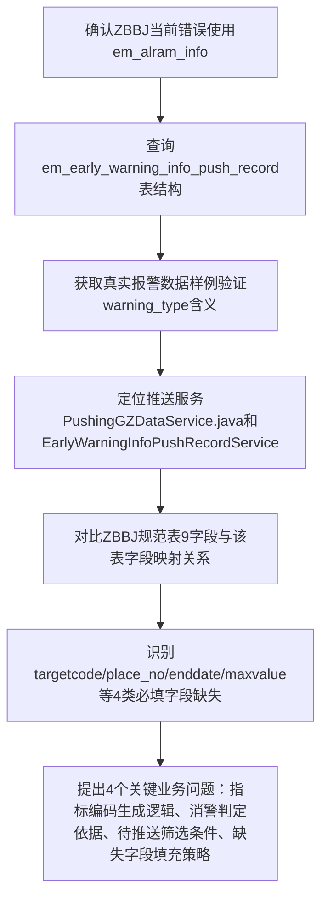

## 任务描述
修正温湿度报警（ZBBJ）推送的数据源，从原错误使用的 `em_alram_info` 表切换为实际业务表 `em_early_warning_info_push_record`，并完成ZBBJ规范字段与该表字段的映射分析及缺失项识别。

## 执行过程

## 任务总结
确认ZBBJ温湿度报警应基于 `em_early_warning_info_push_record` 表（warning_type=0/1），完成全字段映射分析：id/company_code/targettype等12项可映射或默认，但 targetcode、place_no、enddate、maxvalue/maxtime 等5项关键字段缺失，需业务方确认关联逻辑或数据补全方案。
