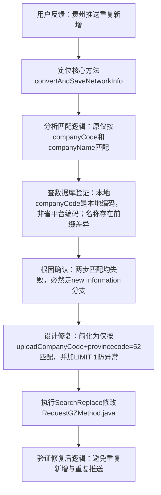

## 任务描述
解决贵州企业信息每次推送都在数据库重复新增的问题。

## 执行过程

## 任务总结
根本原因是贵州企业同步时匹配逻辑不严谨：未优先使用省平台唯一编码 `uploadCompanyCode` 进行匹配。修复方案是彻底移除冗余的 `companyCode` 和 `companyName` 匹配，仅保留 `uploadCompanyCode` + `provincecode=52` 的精确匹配，并强制 `LIMIT 1`，确保每次只匹配一条记录，从源头杜绝重复新增。
