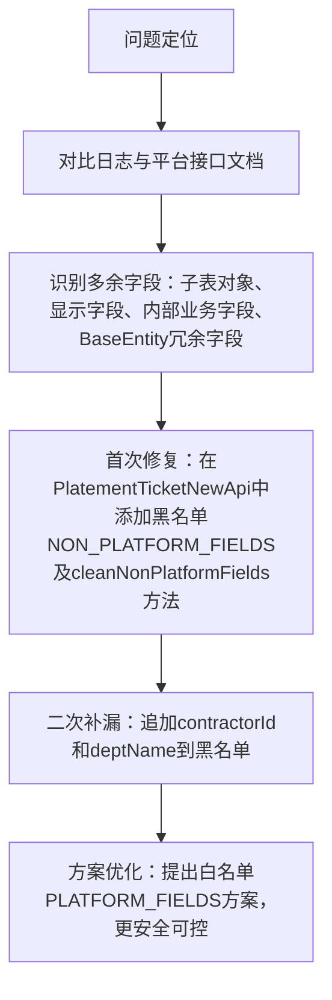

## 任务描述
修复PlatementTicketNewApi推送JSON因携带非平台字段导致500错误的问题。

## 执行过程

## 任务总结
成功建立字段清理机制：实现cleanNonPlatformFields方法，通过黑名单方式移除22类非平台字段（含approveList/sensorList等子表对象、prepareIdShow等显示字段、curOperatorId等内部字段、searchValue/params等BaseEntity冗余字段），并论证白名单方案更优，适用于所有对接外部平台的DTO推送场景。
