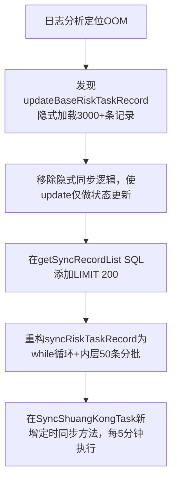

## 任务描述
解决系统因`updTaskRecordStatus`接口隐式全量同步导致的`OutOfMemoryError: GC overhead limit exceeded`问题，通过解耦更新与同步逻辑、SQL限流、分批处理、补充定时任务四步实现根治。

## 执行过程

## 任务总结
成功消除OOM风险：1）`updateBaseRiskTaskRecord`剥离同步职责；2）SQL查询限制为200条；3）`syncRiskTaskRecord`支持分批处理（50条/批）；4）新增定时任务保障同步兜底；5）同步内存峰值从3000+条降至200条以内，彻底规避并发OOM。
