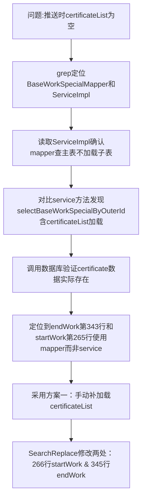

## 任务描述
解决动火/临时用电作业票在开工/完工推送时操作证列表（certificateList）为空导致平台拒绝的问题。

## 执行过程

## 任务总结
根因是推送路径误用 mapper 方法（只查主表），未加载 certificateList；修复方式为在 startWork 和 endWork 的 mapper 查询后，显式调用 baseWorkCertificateMapper.selectWorkCertificateList(outerId) 并 set 到实体，确保推送数据完整性。
