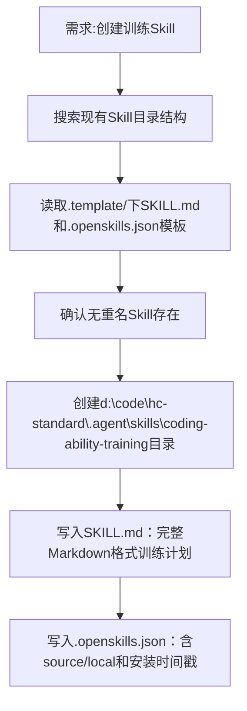

## 任务描述
在 hc-standard 项目中创建名为 coding-ability-training 的新 Skill，用于支持编程能力自主提升训练计划。

## 执行过程

## 任务总结
成功创建 coding-ability-training Skill，包含标准化 SKILL.md（含三阶段训练流程、AI使用边界总则、配套习惯）和 .openskills.json 元数据文件，触发关键词已明确定义，可被系统识别并激活。
