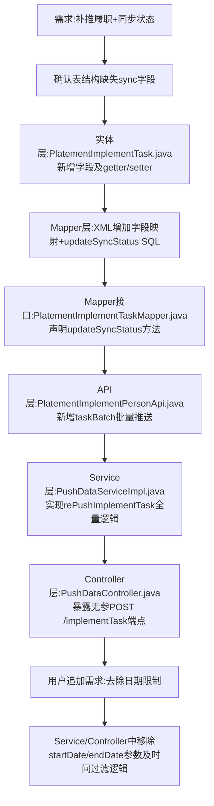

## 任务描述
为包保履职功能（tgr-gz-vue.platement_implement_task 表）新增同步状态（sync_status）和同步结果（sync_result）字段，并实现全量补推接口，支持无参一键重推所有履职记录。

## 执行过程

## 任务总结
成功交付包保履职同步补推能力：新增 sync_status/sync_result 字段并打通全链路，最终提供无参全量补推接口，推送成功标记 status=1、失败标记 status=2 并记录错误详情。
