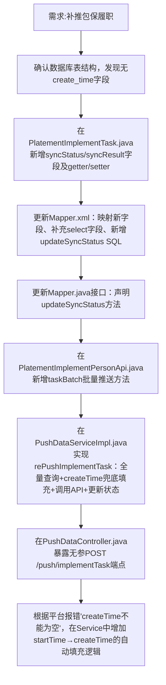

## 任务描述
为包保履职模块实现全量补推功能，支持将本地已存在的PlatementImplementTask数据批量推送至园区平台，并记录同步状态（sync_status）与同步结果（sync_result）。

## 执行过程

## 任务总结
成功交付包保履职补推功能：支持无参全量推送；通过startTime兜底填充createTime解决第三方平台校验失败；同步状态与结果持久化到数据库；所有修改均经代码审查与逻辑验证。
