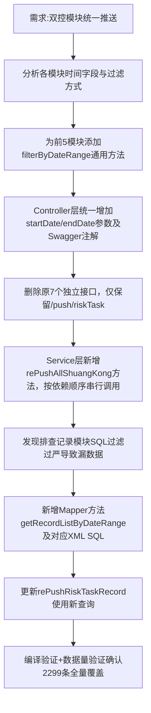

## 任务描述
将双控7个模块（四色图、分析对象、风险单元、风险事件、管控措施、任务排查、排查记录）的独立推送接口，统一整合为单接口 `/push/riskTask`，并确保所有模块严格按6-7月日期范围过滤推送。

## 执行过程

## 任务总结
成功实现双控数据一键全推：统一入口`/push/riskTask`，7模块按依赖顺序执行；前5模块复用`createTime` Java层过滤，排查记录模块采用`check_time` SQL层日期范围查询（修复原`sync_status!=1 AND check_status=1`漏数据问题），任务排查模块保持原有SQL日期过滤；最终6-7月2299条排查记录全部纳入推送范围。
