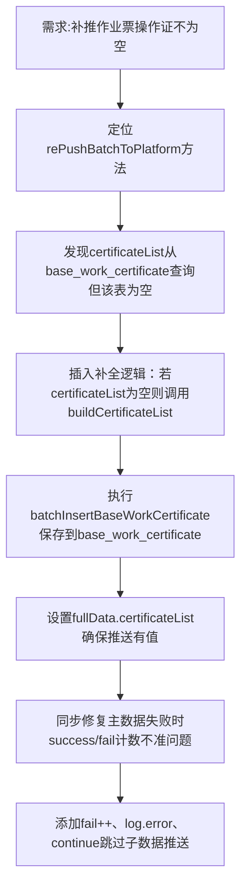

## 任务描述
修复批量补推作业票时因base_work_certificate表为空导致certificateList为空的问题，并修正补推统计逻辑。

## 执行过程

## 任务总结
在BaseWorkSpecialServiceImpl.java中新增证书补全逻辑：补推时自动从base_contractor_people_cert构建并持久化到base_work_certificate；同时修正统计逻辑，主数据失败时准确累加fail并跳过后续推送，确保返回结果真实反映执行状态。
