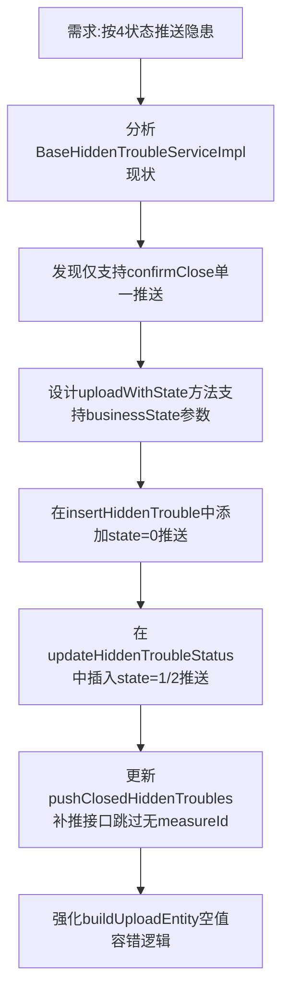

## 任务描述
为隐患状态流转实现4个平台业务状态（0-待治理、1-待验收、2-验收不通过、4-验收通过）的精准推送，并确保无measureId的旧记录被安全跳过。

## 执行过程

## 任务总结
成功实现隐患全生命周期状态推送：新增uploadWithState()方法统一处理4种businessState；在添加、申请关闭、关闭驳回、确认关闭4个节点注入推送；补推接口自动过滤33条无measureId旧数据；buildUploadEntity增加7处空值容错（dangerImages/liablePerson/registrant等），保障必填字段不为空。
