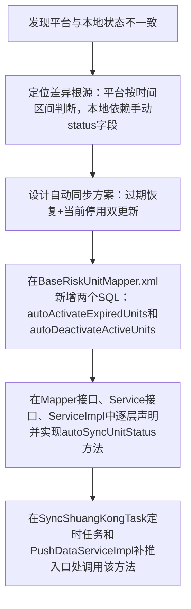

## 任务描述
实现风险单元停用/检维修状态的自动同步逻辑，使本地数据库状态与平台按时间区间（stopTime ~ activationTime）动态判断的逻辑保持一致。

## 执行过程

## 任务总结
成功构建时间感知的状态同步机制：通过两条精准SQL分别处理“过期恢复”和“当前停用”，并在定时同步与人工补推两个关键入口统一调用，确保本地base_risk_unit.status始终与平台时间逻辑一致。
