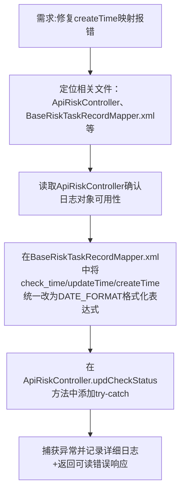

## 任务描述
修复风险巡检任务接口 `/api/risk/updTaskRecordStatus` 中因数据库连接不稳定导致的 `createTime` 字段映射报错问题。

## 执行过程

## 任务总结
成功提升接口健壮性：SQL 层通过 `DATE_FORMAT(check_time,'%Y-%m-%d %H:%i:%s')` 统一时间字段格式，避免 DATETIME → String 直接映射失败；代码层增加结构化异常处理，使测试阶段能直接获取错误原因，无需排查服务器日志。
