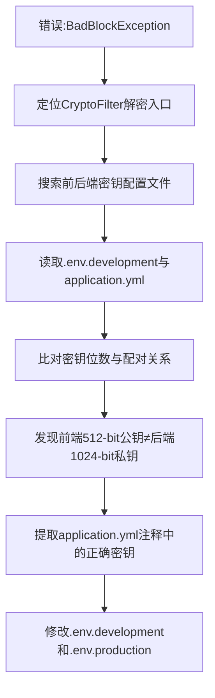

## 任务描述
解决 RSA 解密失败的 BadBlockException 错误，根本原因是前后端 RSA 密钥对不匹配。

## 执行过程

## 任务总结
成功修复 RSA 解密失败：通过比对密钥位数与配对关系，确认前端公钥（512-bit）与后端私钥（1024-bit）不匹配；依据后端 application.yml 注释中提供的正确密钥，精准更新了前端两个环境文件中的 VITE_APP_RSA_PUBLIC_KEY 和 VITE_APP_RSA_PRIVATE_KEY。
