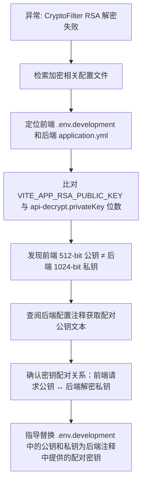

## 任务描述
解决 RSA 解密失败异常 `BadBlockException: unable to decrypt block`，根本原因是前后端 RSA 密钥对不匹配。

## 执行过程

## 任务总结
成功定位 RSA 加解密失败根源为密钥位数与配对关系不一致；明确前后端密钥映射规则（请求加密公钥↔解密私钥，响应加密公钥↔解密私钥）；提供可直接复用的密钥替换方案，避免因密钥不匹配导致的 BadBlockException。
