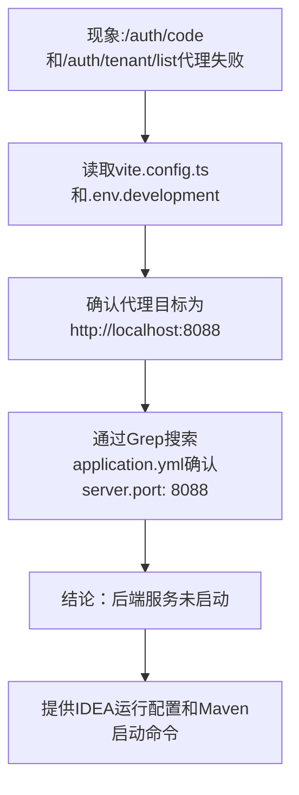

## 任务描述
定位并解决前端 Vite 开发服务器代理请求连接被拒绝（ECONNREFUSED）问题。

## 执行过程

## 任务总结
成功诊断出ECONNREFUSED根本原因为后端Spring Boot服务未启动，通过检查前端代理配置与后端application.yml端口一致性，确认端口匹配（8088），并给出两种启动方式（IDEA run config / Maven命令），确保前后端联调环境就绪。
