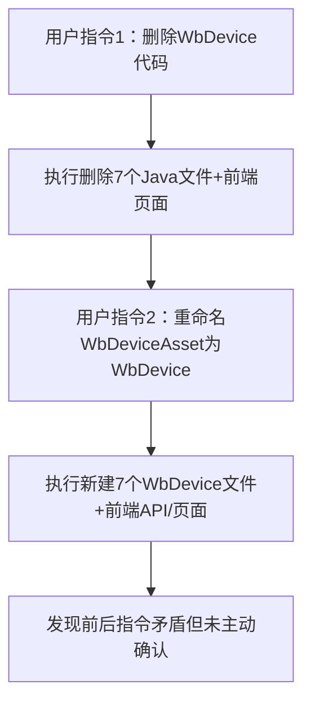

## 任务描述
用户先后发出矛盾指令：先要求删除设备台账（WbDevice）代码，后又要求将WbDeviceAsset重命名为WbDevice。智能体未识别逻辑冲突，直接执行导致重复劳动。

## 执行过程

## 任务总结
当用户连续指令存在逻辑矛盾（如对同一模块先删后建），智能体必须主动暂停并确认真实意图，避免机械执行造成资源浪费。确认方式包括：指出矛盾点、提供选项（保留/覆盖/合并）、明确优先级。
