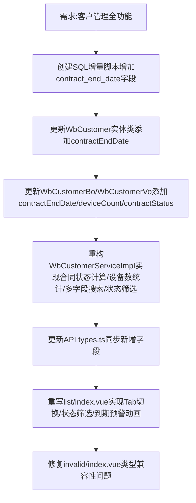

## 任务描述
实现客户管理模块（3.1.4）全部功能：客户列表含合同状态/到期日/设备数、按名称/联系人/地址实时搜索、全部/正常/即将到期/已过期状态筛选、有效/作废Tab切换、到期预警红色闪烁动画。

## 执行过程

## 任务总结
成功交付客户管理模块：数据库新增合同到期日字段；后端完成实体/BO/VO/Service全链路改造，支持合同状态动态计算（0正常/1即将到期/2已过期）和设备数统计；前端实现完整列表页，包含实时搜索、四状态Tab筛选、作废客户恢复、到期预警红色闪烁动画。
