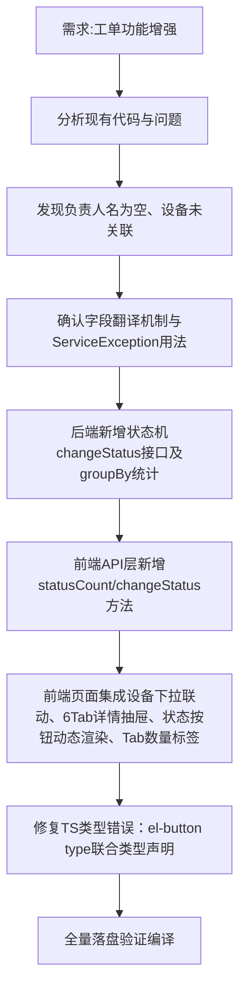

## 任务描述
增强工单列表功能，实现设备表关联、6Tab工单详情抽屉、状态机驱动的状态流转、各状态Tab数量统计。

## 执行过程

## 任务总结
成功交付4项增强：① 设备选择改为先选客户再加载设备下拉，自动带出设备名/位置；② 新增el-drawer 6Tab详情面板（2个真实Tab+4个占位Tab）；③ 后端STATUS_FLOW Map定义0→1→2→3状态机，前端按当前状态动态显示「处理/完成/验收」按钮；④ 后端queryStatusCount groupBy统计+前端tabCount动态渲染，增删/流转后自动刷新。
