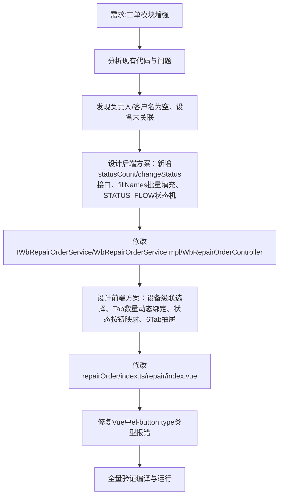

## 任务描述
在工单列表模块中实现4项增强功能：1）设备选择下拉关联设备表；2）工单详情6Tab侧滑面板；3）基于状态机的状态流转（0→1→2→3）；4）各状态Tab数量统计。

## 执行过程

## 任务总结
成功交付工单模块增强：后端新增状态统计与流转接口并实现批量名称填充防N+1；前端实现设备级联选择、Tab数量实时刷新、状态按钮动态渲染及6Tab详情抽屉；关键修复了Vue中el-button type联合类型声明错误。
