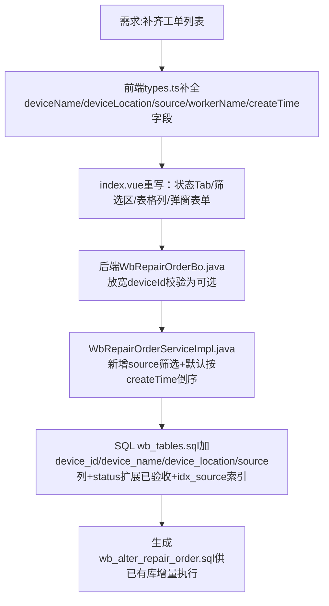

## 任务描述
完成维保工单列表功能，支持状态Tab切换（全部/待处理/处理中/已完成/已验收）、按工单号/来源/优先级筛选、表格展示设备/位置/来源/故障描述/优先级(P1-P4颜色区分)/负责人/报修时间/状态，并支持排序。

## 执行过程

## 任务总结
工单列表功能完整交付：前端支持5状态Tab、4项筛选、8列展示（含P1-P4颜色标签）、排序；后端支持source筛选与createTime倒序；SQL同步更新表结构与索引。
