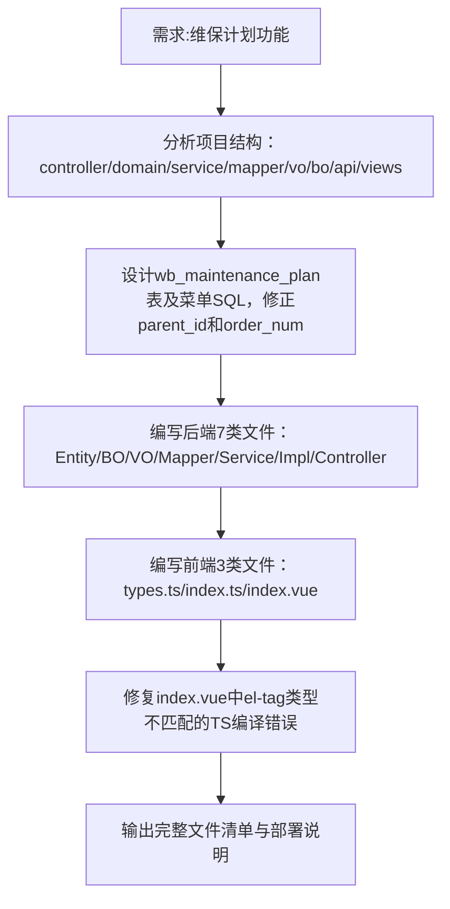

## 任务描述
为维保管理系统新增'维保计划'功能模块，严格遵循RuoYi-Plus架构规范，集成至'维保管理'父菜单下（parent_id=1900800000000000000），支持分类Tab、卡片式列表、进度条、AI推荐和弹窗创建。

## 执行过程

## 任务总结
成功交付维保计划模块：数据库建表+菜单权限SQL已生成；后端实现完整CRUD+进度更新接口；前端实现Tab筛选、3列卡片布局、动态AI推荐、进度条可视化及弹窗表单；所有代码严格对齐项目现有模式，TypeScript类型错误已修复。
