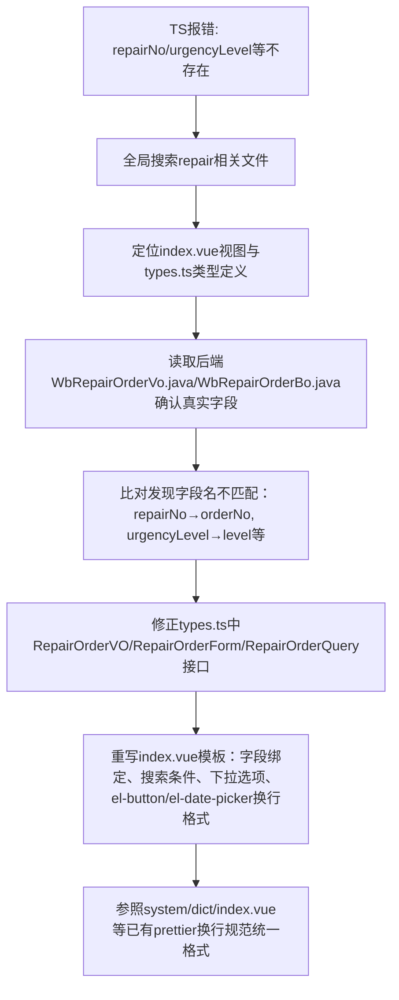

## 任务描述
修复维修单模块 TS2339 字段不存在错误及 prettier 格式问题，实现前端字段与后端 WbRepairOrderVo/WbRepairOrderBo 实体完全对齐。

## 执行过程

## 任务总结
成功修复维修单模块：1）types.ts 中 RepairOrderVO/RepairOrderForm/RepairOrderQuery 全部按后端 VO/BO 字段重定义；2）index.vue 视图彻底重构，移除无效字段（reporterName/planFinishTime等），补充必填字段（deviceId/source），Tab筛选改为 level 值驱动，状态文案与后端枚举严格一致；3）所有 el-button/el-date-picker 等长标签按项目既有 prettier 规范换行。
