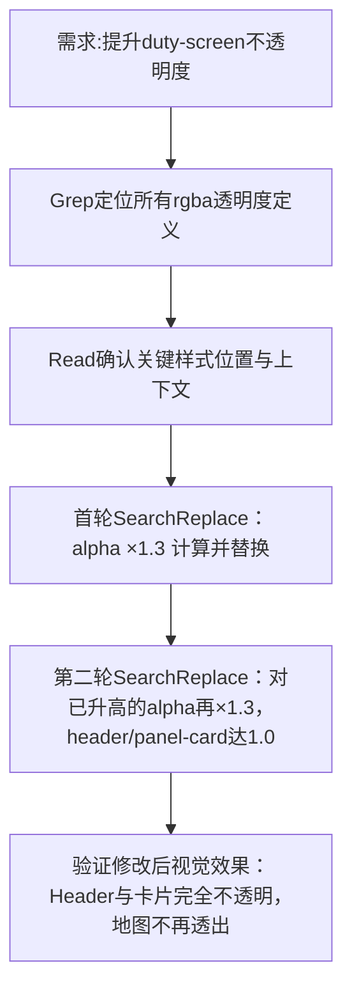

## 任务描述
在 duty-screen 页面中渐进式提高多个 UI 元素的背景不透明度，解决地图内容透过面板显示的问题。

## 执行过程

## 任务总结
成功完成两轮不透明度增强：header 和 panel-card 的渐变背景 alpha 值从 0.70/0.65/0.70 经两次 ×1.3 后升至 1.0（完全不透明）；ent-header-bar 及其 hover 状态 alpha 也同步提升，显著改善深色主题下地图与UI层叠的可读性。
