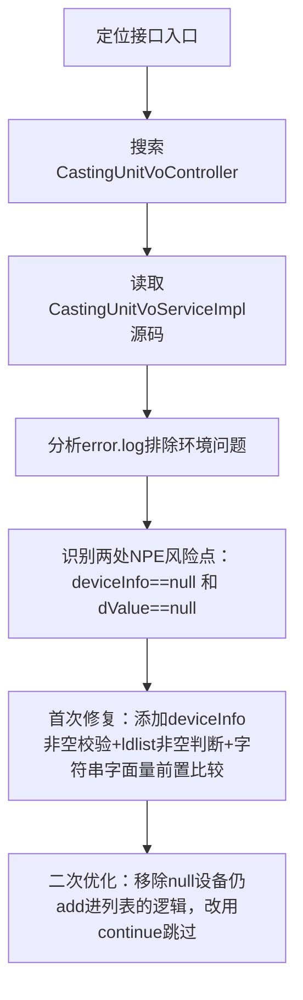

## 任务描述
修复 /zzdy/getCastingUnitVoList 接口因 CastingUnitVoServiceImpl 中空指针（NPE）导致的'未知异常'。

## 执行过程

## 任务总结
成功修复NPE：在 getCastingUnitVo 方法中，对 selectDeviceInfoByDeviceId 返回值做 null 判断并 continue 跳过；对 List 遍历前加 null 安全检查；将所有 "str".equals(obj) 替换为安全比较，彻底消除该接口的未知异常。
