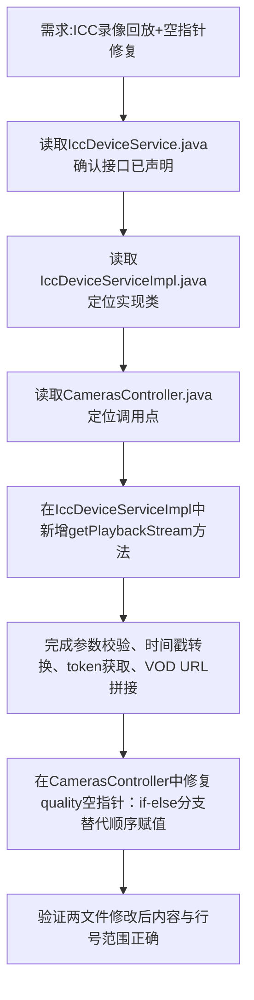

## 任务描述
为大华ICC设备服务新增录像回放接口 getPlaybackStream，并修复 CamerasController 中 quality 字段的空指针异常。

## 执行过程

## 任务总结
成功交付ICC录像回放能力：在 IccDeviceServiceImpl 新增 getPlaybackStream 方法（支持设备编码/通道/时间范围生成 m3u8 回放地址），并修复 CamerasController 中 camera 为空时 quality 赋值导致的 NPE；URL 使用 ICC VOD 专用端口 7086，token 从 iccAuthService 动态获取。
