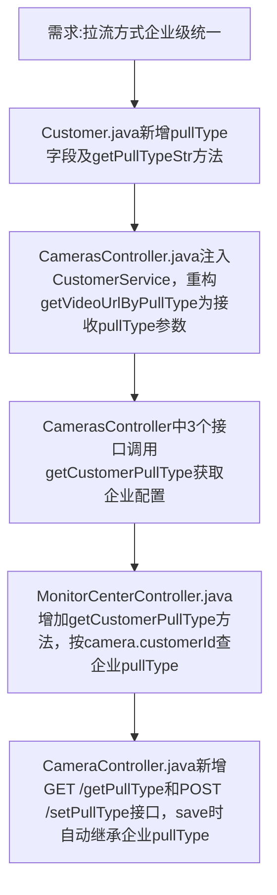

## 任务描述
将拉流方式判断逻辑从摄像头级（Camera.pullType）升级为企业级（Customer.pullType），新增企业级配置接口，并确保所有视频相关接口（/geturl、/geturlStr、/getHuifang、报警弹窗）均按企业配置生效。

## 执行过程

## 任务总结
成功实现拉流方式企业级管控：Customer实体新增pullType字段；CamerasController与MonitorCenterController中全部视频地址生成逻辑改为从Customer读取；CameraController新增企业级配置接口及摄像头创建时自动继承逻辑；所有改动经grep验证无残留camera.getPullType()调用。
