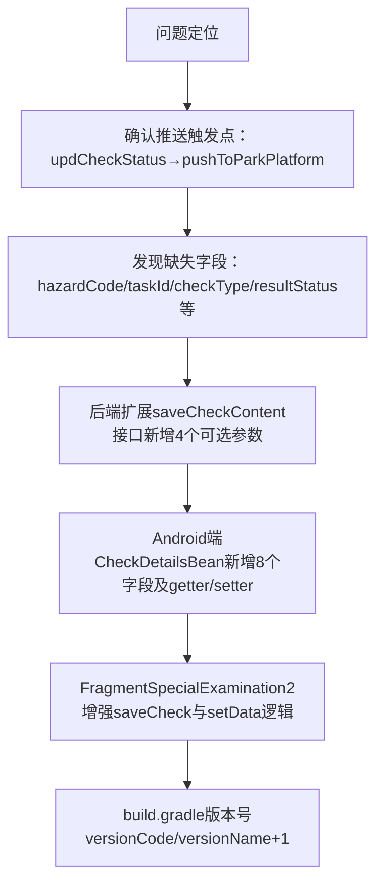

## 任务描述
为移动端专项检查功能补充推送所需字段，解决 `saveTaskResult` 和 `saveTaskItemLog` 推送时关键字段为空的问题，并同步升级移动端版本号。

## 执行过程

## 任务总结
成功打通移动端专项检查数据推送通道：后端 `saveCheckContent` 接口支持 `harmType`/`checkScoreId`/`checkPay`/`dangerId`；Android `CheckDetailsBean` 外部类与 `ContentList` 内部类各新增4字段；`FragmentSpecialExamination2` 实现字段读取与提交；版本号由 86→87。数据通道已就绪，后续可按需补充UI录入控件。
