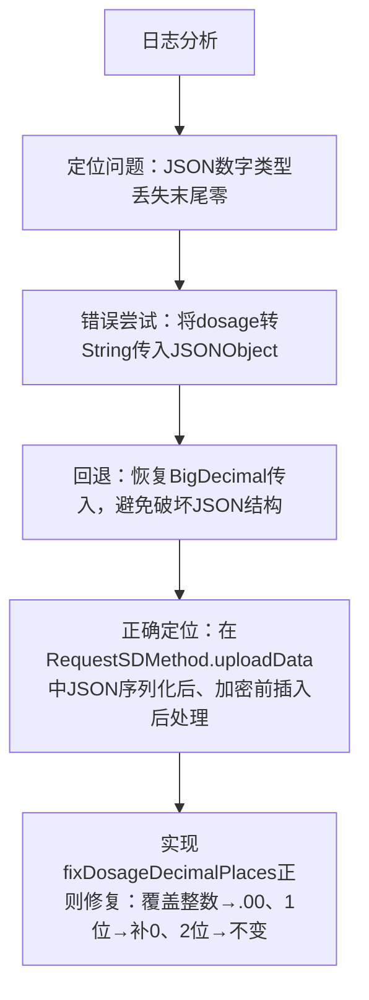

## 任务描述
修复SD平台`dosage`字段小数位校验失败问题：FastJSON将BigDecimal(28260.00)序列化为数字28260.0，导致SD平台校验"需精准2位小数"失败。

## 执行过程

## 任务总结
通过在RequestSDMethod.uploadData中添加JSON字符串级正则后处理，精准修复dosage字段小数位：匹配`"dosage":N`→`"dosage":N.00`，`"dosage":N.M`→`"dosage":N.M0`，确保SD平台接收到符合要求的数字格式（如`"dosage":28260.00`）。
