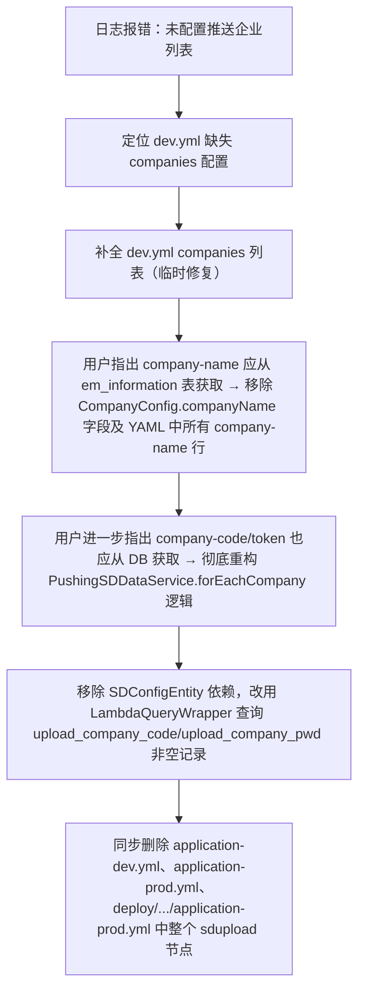

## 任务描述
将山东平台（SD）企业信息推送功能由 YAML 配置驱动，全面迁移至数据库驱动：移除所有 YAML 中的 sdupload.companies 配置，代码中不再读取 SDConfigEntity，改为直接查询 em_information 表中 upload_company_code 和 upload_company_pwd 非空的企业记录。

## 执行过程

## 任务总结
成功实现 SD 推送配置零 YAML 化：代码层完全解耦 SDConfigEntity，通过数据库字段动态识别企业；三处 YAML 配置文件中 sdupload 节点被彻底清除；企业增删仅需维护 em_information 表，大幅提升可维护性与一致性。
