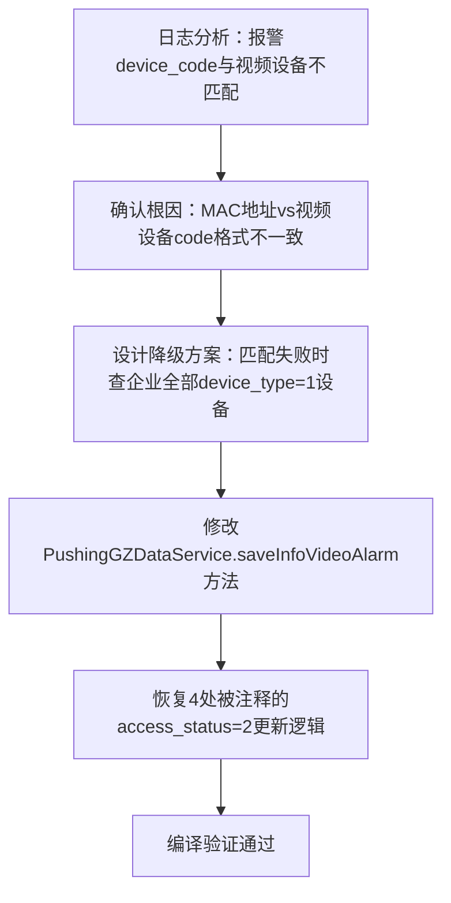

## 任务描述
修复视频报警数据（SXTFX）因设备编码不匹配导致推送跳过的问题，并统一恢复所有报警类推送成功后将access_status置为2的逻辑。

## 执行过程

## 任务总结
成功修复SXTFX推送失败问题：在saveInfoVideoAlarm中增加降级查询逻辑，当报警device_code无法匹配视频设备时自动回退至查询该企业全部视频设备；同时启用ZBBJ/RYCRJL/CLCRJL/SXTFX四类报警推送成功后的access_status=2状态更新，确保数据同步状态准确。
