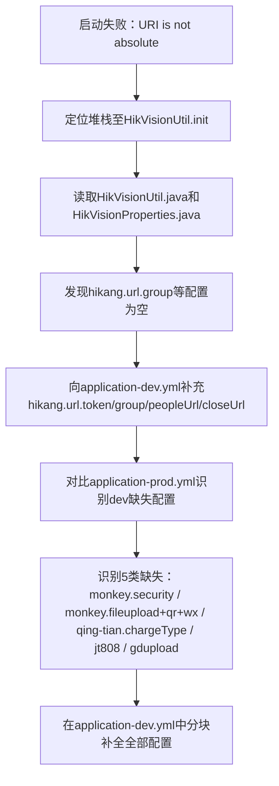

## 任务描述
修复 Spring Boot 应用启动失败问题，根因为 HikVisionUtil 初始化时因 hikang.url 配置缺失导致 URI is not absolute 异常，并同步补齐 dev 环境缺失的 prod 关键配置。

## 执行过程

## 任务总结
成功修复启动异常：先补全海康 URL 必填项避免 init 失败；再通过 prod/dev 配置对比，系统性补齐 OAuth2 安全、文件/二维码/微信、JT808 端口、广东数据上传、青天充电类型共 5 类配置，确保 dev 环境功能完整性与 prod 对齐。
