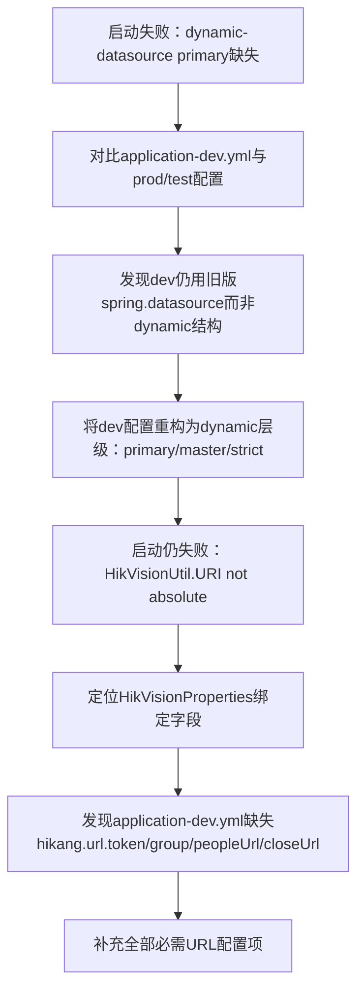

## 任务描述
修复 Spring Boot 应用在 dev 环境启动失败问题，包含两个关联故障：1）baomidou dynamic-datasource 缺少 primary 配置；2）HikVisionUtil 初始化时因海康 URL 配置缺失导致 URI not absolute 异常。

## 执行过程

## 任务总结
成功修复双阶段启动异常：1）统一 dev 环境 dynamic-datasource 配置结构，显式声明 primary: master；2）补全海康云平台所有必需 API 地址，确保 HikVisionUtil 初始化时 URL 字符串非空且绝对。
