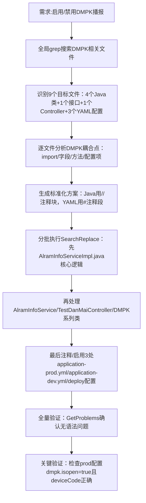

## 任务描述
在分支切换后，彻底注释禁用丹唛派克（DMPK）语音播报功能，保留华皓音柱通道，实现双路播报退化为单路；或在新分支上启用并修复DMPK播报链路。

## 执行过程

## 任务总结
成功完成DMPK功能双向操作：
- 禁用场景：9个文件全部按规范注释，包括服务层调用链、配置实体、API测试入口及三处环境配置；注释后系统仅保留华皓音柱播报。
- 启用场景：生产环境 dmpk.isopen=true，dmpk.deviceCode=9C0CA428，alarm-voice.repeat-count=5；AlramInfoServiceImpl.java和DanMaiPaiKe.java已修复并添加全链路日志。
