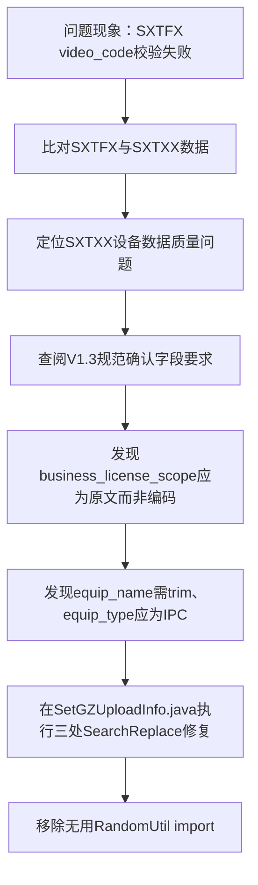

## 任务描述
依据《烟花爆竹企业仓库安全风险监测预警系统数据接入规范-V1.3》，修复SXTXX视频设备信息推送中`equip_name`含制表符、`equip_type`为随机字符串、`business_license_scope`被错误编码等问题，确保SXTXX成功入库，从而解决SXTFX视频报警因‘视频编码不存在’报错的问题。

## 执行过程

## 任务总结
成功修复SXTXX设备信息合规性：1）`business_license_scope`回退为原文；2）`equip_name`增加`.trim()`清洗；3）`equip_type`兜底值改为规范要求的`"IPC"`；4）清理冗余import。修复后SXTXX可正常入库，SXTFX视频编码校验错误将消除。
