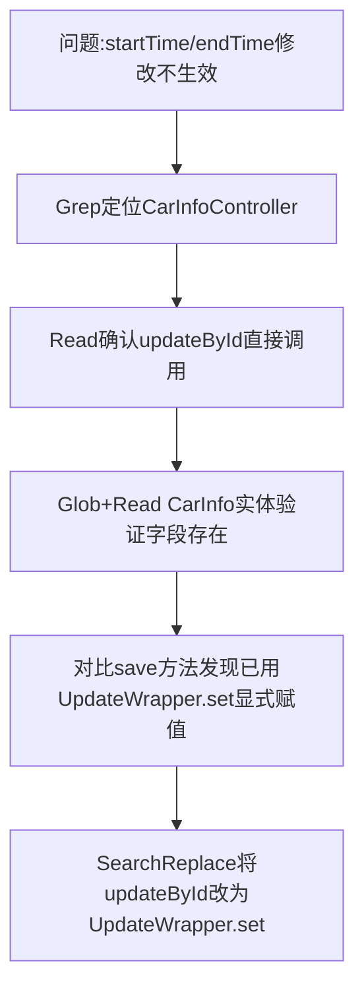

## 任务描述
修复 /em/car/update 接口中 startTime 和 endTime 字段无法更新的问题。

## 执行过程

## 任务总结
根因是 MyBatis-Plus updateById 忽略 null 字段；修复方式为改用 UpdateWrapper 显式 .set("start_time", ...) 和 .set("end_time", ...)，确保即使传 null 也强制更新数据库字段，与 save 方法保持一致。

## Notes
- 除UpdateWrapper方案外，还可将实体字段的@TableField(updateStrategy)属性设为FieldStrategy.IGNORED，使null值也能被写入数据库，实现真正的清空语义。
