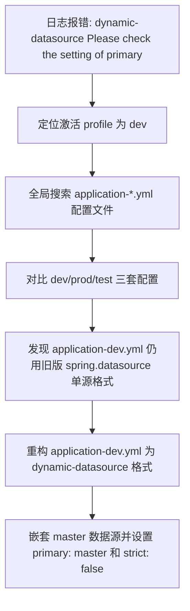

## 任务描述
修复 Spring Boot 应用因 baomidou dynamic-datasource 在 dev 环境缺失 `primary` 配置导致的启动失败问题。

## 执行过程

## 任务总结
成功解决 dynamic-datasource 启动异常：通过环境配置一致性比对，将 application-dev.yml 迁移至标准 dynamic-datasource 结构，确保 `spring.datasource.dynamic.primary` 正确指向 `master`，且 `strict: false` 提供容错能力。
