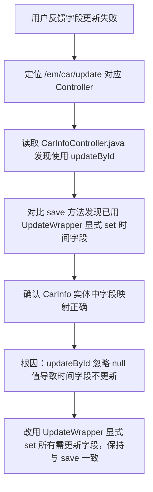

## 任务描述
修复 `/em/car/update` 接口无法更新 `startTime` 和 `endTime` 字段的问题。

## 执行过程

## 任务总结
通过将 `updateById` 替换为 `UpdateWrapper.set(...)`，强制更新 `startTime`/`endTime`（即使为 null），解决字段更新失效问题，确保与 `save` 方法行为一致。

## Notes
- 除UpdateWrapper方案外，还可将实体字段的@TableField(updateStrategy)属性设为FieldStrategy.IGNORED，使null值也能被写入数据库，实现真正的清空语义。
