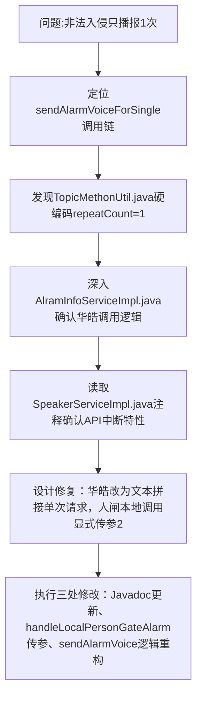

## 任务描述
解决非法入侵车闸语音播报仅一次的问题，根因是华皓音柱StartTTSBroadcast接口设计为“连续下发会中断前一次”，导致代码中循环调用两次实际只播一次。

## 执行过程

## 任务总结
根本性修复华皓播报中断问题：将循环调用改为文本重复拼接（如"警告...;警告...;"）后单次HTTP请求；同步统一人闸本地报警调用为sendAlarmVoiceForSingle(alarm, 2)；丹唛派克保持原队列循环逻辑。确保所有非法入侵路径均稳定播报2次。
