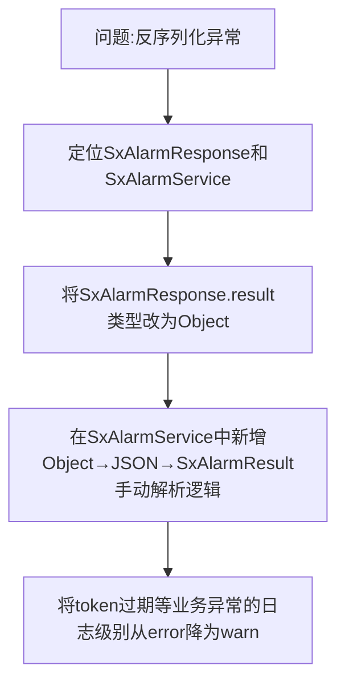

## 任务描述
解决四相报警接口因result字段在成功时为SxAlarmResult对象、失败时为字符串而导致的FastJSON反序列化异常问题。

## 执行过程

## 任务总结
通过将响应体result字段统一声明为Object，并在服务层手动解析，兼容了API返回结果的动态类型；同时将token失效等可预期业务异常日志降级为warn，避免污染error日志。该方案适用于下游API响应结构不稳定（success/fail返回不同数据类型）的集成场景。
