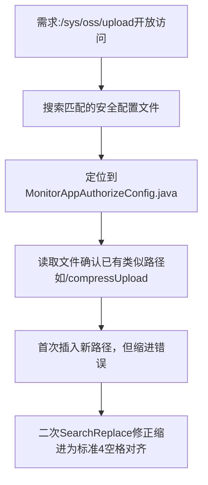

## 任务描述
为 /sys/oss/upload 接口在 MonitorAppAuthorizeConfig.java 中配置 permitAll 放行规则。

## 执行过程

## 任务总结
成功为 /sys/oss/upload 添加 permitAll 放行配置，关键点在于：必须与同组路径（如 /sys/oss/compressUpload）保持一致缩进（4空格），避免因缩进错误导致编译失败或配置不生效。
