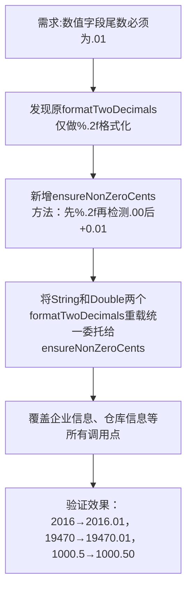

## 任务描述
解决山东平台对数值字段的特殊校验要求：所有需保留2位小数的字段（如storeroomArea、reservoirArea、acreage、dosage）尾数不能为.00，必须至少为.01。

## 执行过程

## 任务总结
通过引入ensureNonZeroCents核心方法，统一处理所有数值字段的“.01强制规则”，避免平台校验失败；该方案兼顾兼容性（非.00值不变）与强制性（.00自动转.01），已应用于socialCreditScope默认值、storeroomArea、reservoirArea、acreage、dosage等全部相关字段。
