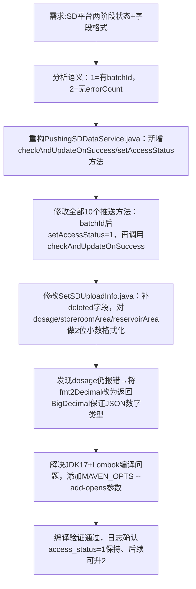

## 任务描述
为山东平台（SD）实现两阶段access_status更新机制：batchId返回时设为1（已提交待校验），批次校验无错误时升为2（确认成功）；同时修复dosage/storeroomArea/reservoirArea等字段小数位数不合规问题。

## 执行过程

## 任务总结
成功落地SD平台两阶段状态机制：所有推送方法统一支持access_status=1→2流转；通过fmt2Decimal(BigDecimal)和fmt2DecimalStr(String)双策略精准满足数值/字符串字段的2位小数要求；关键方法位置明确（如checkAndUpdateOnSuccess在PushingSDDataService.java#L68-L100），可直接复用于其他平台对接。
