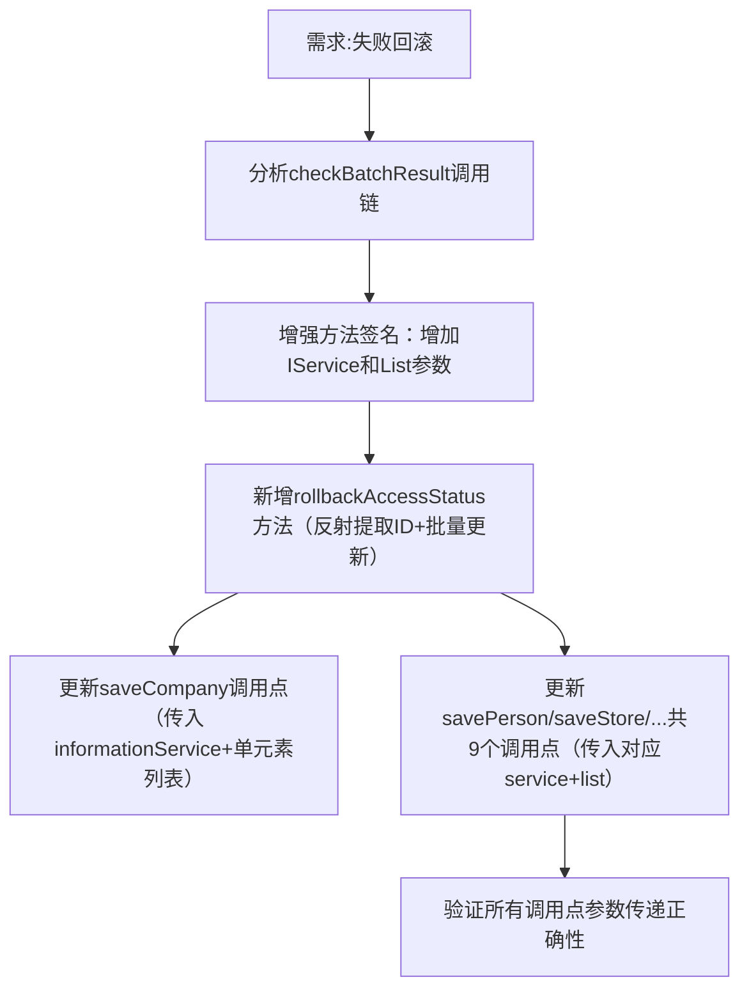

## 任务描述
为山东平台推送功能增加失败回滚逻辑：当checkBatchResult检测到批次内errorCount >= totalCount（全部失败）时，将本地access_status回滚为1，确保下次调度重新推送。

## 执行过程

## 任务总结
成功实现异步校验失败回滚机制：checkBatchResult支持泛型服务与实体列表，rollbackAccessStatus通过反射安全提取ID并批量回滚access_status=1；覆盖企业、人员、仓库等10类数据推送，确保全部失败时自动重推。

## Notes
- 【本条核心结论已被推翻】"回滚access_status=1"是错误的：SD各推送方法查询条件均为 `.eq(access_status, 0)`，置1后下轮永远扫不到，数据永久丢失。最新实现已将方法改名为 `resetAccessStatus` 并重置为 **0**，同时把平台失败原因写入 `sync_reason` 字段留痕。后续以任何"回滚为1等待重推"的写法指导改动都会引入丢数据缺陷，须以本Notes为准。
