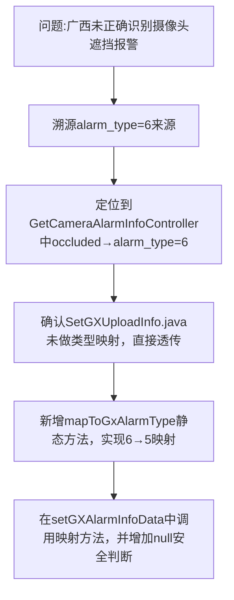

## 任务描述
修复广西数据推送中 alarm_type=6 语义不一致问题：本地系统将摄像头遮挡标记为6，但广西平台规范中6代表温度报警，5才代表摄像头遮挡偏移。

## 执行过程

## 任务总结
成功修复广西报警类型语义错配：在 SetGXUploadInfo.java 中新增 mapToGxAlarmType 方法，将本地 alarm_type=6（摄像头遮挡）统一映射为广西规范值 5（摄像头遮挡偏移），并在调用处增加 null 判断，确保推送数据符合广西平台接口规范。
