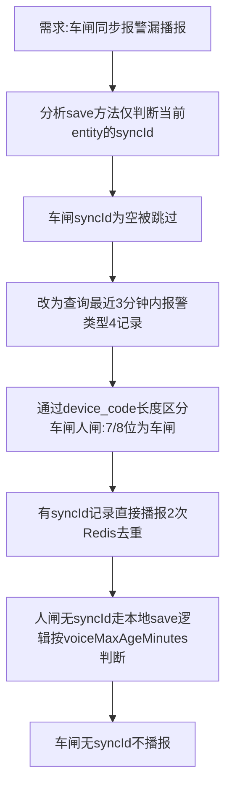

## 任务描述
为em_alram_info表实现非法入侵报警（alarm_type=4）的语音播报覆盖，解决车闸等外部系统同步写入数据库（跳过save方法播报逻辑）导致的漏播报问题。

## 执行过程

## 任务总结
在AlramInfoServiceImpl.save方法中，对于报警类型4，不再仅判断当前entity的syncId，而是查询最近3分钟内报警类型4的未消警记录（limit 50），对每条记录通过device_code长度区分车闸/人闸，有syncId的直接播报（Redis setNx去重，key=alarm:voice:broadcast:{syncId}，过期180秒），人闸无syncId走本地save逻辑，车闸无syncId不播报。注入RedisUtils，新增handleIllegalIntrusionAlarms、isCarPlateLength、broadcastWithDedup、handleLocalPersonGateAlarm四个方法。

## Notes
- 本条与「车闸报警语音播报逻辑重构」（id 5370cf7a-9b2a-4c92-9cff-2ed969443e53）记录的是同一次改动，内容完全重叠；该条为权威版本，后续查阅以它为准，本条仅作历史快照保留。
- 其中"扫描窗口与过期时间统一为3分钟"的描述已过时：现行轮询窗口为最近 2 分钟（见 project_introduction「非法入侵报警2分钟轮询窗口与device_code长度分车闸人闸规则」），排障时按 2 分钟核对。
