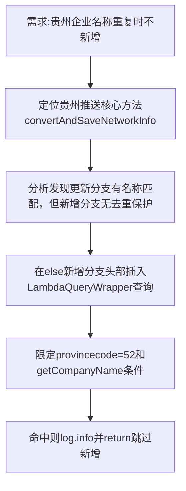

## 任务描述
为贵州企业数据推送功能增加企业名称去重保护：当数据库中已存在同名且provincecode=52的企业时，跳过新增操作。

## 执行过程

## 任务总结
在RequestGZMethod.java的convertAndSaveNetworkInfo方法else分支中，新增了基于provincecode=52和企业名称的双重校验逻辑，避免贵州企业因名称重复被重复插入，日志明确标识跳过行为。
