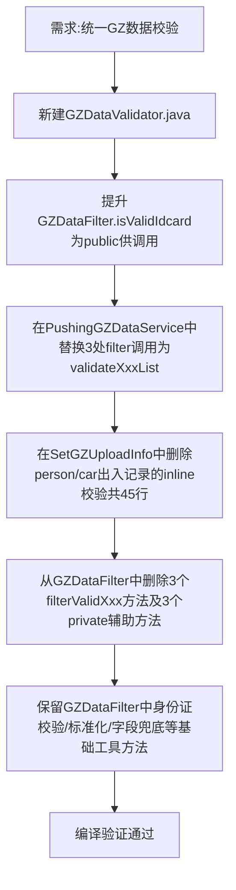

## 任务描述
重构贵州平台（GZ）数据校验逻辑，将分散在 PushingGZDataService 和 SetGZUploadInfo 中的重复校验，统一收口至新建的 GZDataValidator 类，并清理 GZDataFilter 中已迁移的冗余 filter 方法。

## 执行过程

## 任务总结
成功建立分层校验体系：GZDataValidator 负责推送前批量过滤（覆盖12类数据），GZDataFilter 降级为纯工具类（仅提供 isValidIdcard/normalizeIdcard/resolveXXX 等底层能力），PushingGZDataService 和 SetGZUploadInfo 不再承担校验职责，代码更清晰、可维护性显著提升。
