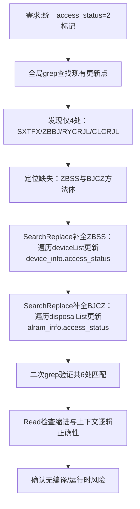

## 任务描述
修复贵州推送中 ZBSS（监测指标实时数据）、BJCZ（监测指标报警处置）两类数据缺少 `access_status=2` 标记的问题，使全部6类增量推送数据（ZBSS、BJCZ、SXTFX、ZBBJ、RYCRJL、CLCRJL）在上传成功后统一更新状态。

## 执行过程

## 任务总结
成功补全 ZBSS 和 BJCZ 的 `access_status=2` 更新逻辑：ZBSS 更新 `device_info_yh` 表，BJCZ 更新 `alram_info` 表；6类数据全部实现“上传成功即标记为2”，保障增量推送状态一致性。
