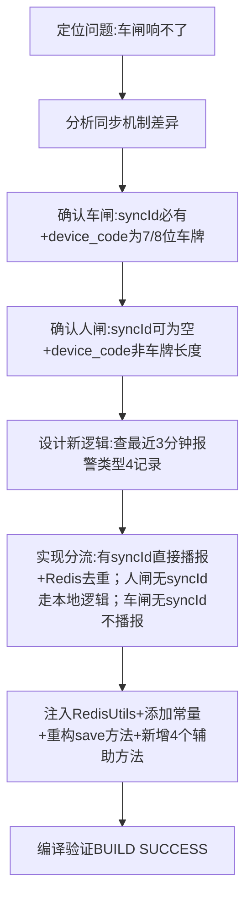

## 任务描述
修复车闸报警语音播报失效问题：车闸数据通过同步方式写入数据库（有syncId，device_code为车牌号码），原save方法仅判断当前entity的syncId导致跳过播报。

## 执行过程

## 任务总结
成功修复车闸播报问题：在AlramInfoServiceImpl中新增handleIllegalIntrusionAlarms等4个方法，通过device_code长度（7/8位=车闸）和syncId有无实现三路分流，使用Redis setNx防止重复播报，扫描窗口与过期时间统一为3分钟。
